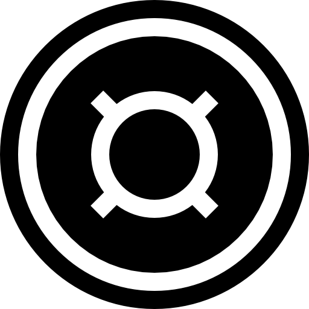
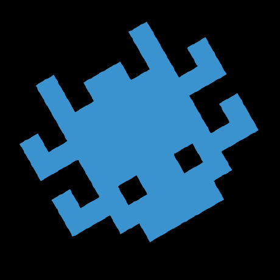

## transl8

transl8 is a syntax translator and query generator for network search engines. it can help compile cross-platform queries for various global network scan data providers.

the web service is available at [transl8.watchdawg.io](https://transl8.watchdawg.io)

there are two CSV's which define the data presented on the above site;

- [ `queries.csv` ](https://github.com/joshhighet/transl8/blob/main/queries.csv) - _the query lookup table_
- [ `providers.csv` ](https://github.com/joshhighet/transl8/blob/main/providers.csv) - _the search provider configuration table_

when proposing query changes, PR one of the above - a GitHub action will automatically update the lookups leveraged by the web service.

| Platform                            | Login Location                             | Query Documentation                               |
|-------------------------------------|--------------------------------------------|---------------------------------------------------|
| [ ZoomEye](https://www.zoomeye.ai)  | [zoomeye.ai/login](https://www.zoomeye.ai/cas/en-US/ui/loginin) | [zoomeye.ai/doc](https://www.zoomeye.ai) |
| [ Censys](https://censys.io) | [censys.io/login](https://censys.io/login)                                | [search.censys.io/search/definitions](https://search.censys.io/search/definitions?resource=hosts) |
| [FOFA Search](https://en.fofa.info) | [en.fofa.info/f_login](https://en.fofa.info/f_login) | [en.fofa.info/api](https://en.fofa.info/api) |
| [ Quake 360](https://quake.360.net) | [quake.360.net/quake/login#/](https://quake.360.net/quake/login#/) | [quake.360.net/quake/#/help](https://quake.360.net/quake/#/help?id=5eb238f110d2e850d5c6aec8&title=检索关键词) |
| [ Netlas](https://app.netlas.io) | [app.netlas.io/login/](https://app.netlas.io/login/) | [app.netlas.io/responses/](https://app.netlas.io/responses/) |
| [ Onyphe](https://www.onyphe.io) | [search.onyphe.io/signin](https://search.onyphe.io/signin) | [search.onyphe.io/docs](https://search.onyphe.io/docs) | 
| [ Criminal IP](https://www.criminalip.io)   | [criminalip.io/en/login](https://www.criminalip.io/en/mypage/information) | [criminalip.io/en/developer](https://www.criminalip.io/en/developer/filters-and-tags/filters) |
| [ Hunter](https://hunter.how) | [hunter.how/profile](https://hunter.how/profile) | [hunter.how/guide](https://hunter.how/guide) |
| [ Shodan](https://account.shodan.io) | [account.shodan.io/login](https://account.shodan.io/login) | [beta.shodan.io/search/filters](https://beta.shodan.io/search/filters) |
| [ urlscan.io](https://urlscan.io) | [urlscan.io/user/login/](https://urlscan.io/user/login) | [urlscan.io/docs/search/](https://urlscan.io/docs/search) |

### local devel

there is no build step - it is a static site. serve the repo root over http
(ES modules will not load over `file://`):

```bash
python3 -m http.server 8000
open http://localhost:8000
```

after editing either CSV, regenerate the lookups the site reads:

```bash
python3 scripts/csv2json.py providers.csv data/providers.json
python3 scripts/csv2json.py queries.csv data/queries.json
```

### tests

query generation lives in `querygen.js`, kept free of DOM access so it can be
tested directly. no dependencies - node's built-in runner:

```bash
node --test tests/
```

the suite covers the query builder, the operator invariants (no dangling or
contradictory operators in any provider/operator combination), a DOM-stub smoke
test of `app.js`, and the integrity of both CSVs - including that `data/*.json`
is not stale relative to them.

to re-check that every provider's search and docs URL is still alive (hits third
parties, so it is not part of CI, and some will answer 403 to a bot):

```bash
python3 scripts/check_urls.py
```

### syntax verification status

every provider's operators were run against the live engine, signed in, with
the result counts and facets checked for semantics rather than just for a
parse. this table records what each run showed. the test suite pins the
verified forms and the two cases that are blocked rather than unchecked.

| provider | status | how |
|---|---|---|
| urlscan | **verified live** | public search API; `AND NOT country:"US"` confirmed to actually exclude |
| zoomeye | **verified live** | `country="US" && port="53"` → 5.4M parsed results; the previous `country:"US" + not port:"53"` parsed to nothing |
| netlas | **verified live** | `geo.country:"US" AND NOT port:"53"` → 323M, correctly excluding port 53 |
| censys | **verified live** | signed in; 1,016,663 without the NOT vs 905,043 with `not host.services.software.product:"nginx"`. `services.port` is rejected as invalid where `host.services.port` validates |
| shodan, shodan-images | **verified live** | signed in; see below — all three operators were wrong |
| hunter | **verified live** | `ip.country=="US" && ip.port=="53"` → 2,260,308 (100% US/53); `ip.port=="53" && ip.country!=="US"` → 6,138,537 with **no US** in the facet |
| criminalip, criminalip-images | **verified live** | signed in; `AND` 661,004 (100% US/53), the bare-space form gives the same 661,004, `NOT port: 53` → 77,125,383 (top port 443), `OR` renders as two filter blocks joined by an OR pill |
| quake360 | **verified live** | signed in; `country:"United States" and port:"53"` → ~4.68M (hit in New York on 53/dns-tcp); `and not port:"53"` returns 443/http and 22/ssh; `country:"New Zealand" or port:"7547"` returns a Mexican host matching on the port alone |
| onyphe | **verified live, OR tier-blocked** | signed in; `country:"US" port:"53"` → 12,631,895, `country:"US" !port:"53"` → 1,392,028,527 (first hit :443). The `?` OR is documented OQL but the account returns `400 Operator access denied` |
| fofa | **AND verified live, NOT blocked** | `country="US" && port="53"` → 967,285 (100% US/53). The `!=` follow-up hit fofa's CAPTCHA / `[-3000] IP access is abnormal` crawler block while signed out |

#### what the live runs changed

shodan was the worst of these. the `and` / `or` / `not` keywords in the table
were not operators at all — shodan matches them as literal banner text:

| query | results |
|---|---|
| `country:"US" port:"53"` | 1,066,743 |
| `country:"US" and port:"53"` | **66** — banners reading *"Help! I'm trapped in a DNS server and can't get out!"* |
| `country:"US" not port:"53"` | **8,042** — still all port 53, banners reading *"not currently available"* |
| `country:"US" -port:"53"` | 201,751,353 — top ports 443/80/22, no 53 |
| `port:"53" or port:"7547"` | **no results found** |
| `port:53,7547` | 41,482,986 — the union, via the same-field comma form |

so shodan now emits an implicit space for AND, `-field:"v"` for NOT, and
**refuses** OR, since its only union is the same-field comma form that this
one-row-per-field model cannot express.

onyphe's `prefix` was also wrong: `https://search.onyphe.io/?q=` renders the
landing page and silently drops the query. the working deep link is
`https://search.onyphe.io/search?q=`.

the two blocked cases above are recorded in `tests/querygen.test.mjs` so they
stay visible rather than passing as checked.

### provider table columns

`providers.csv` describes how to assemble a query for each provider:

| column | meaning |
|---|---|
| `prefix` | search URL the generated query is appended to |
| `kv_separator` | joins a field to its value, e.g. `:` or `=` or `==` |
| `query_separator` | joins two terms when no explicit operator applies (implicit AND) |
| `operators/and` `operators/or` `operators/not` | the provider's boolean keywords; blank means unsupported |
| `not_style` | how negation attaches - see below |
| `as_includeprefix` | whether an ASN needs the `AS` prefix |

`not_style` is one of:

- `prefix` - `NOT field:"value"` (the default)
- `tight-unquoted` - `-field: value` (criminalip)
- `kv` - negation replaces the separator, `field!="value"` (fofa, hunter)

a blank `operators/and` falls back to `query_separator`, since joining terms
with a space is still an AND. a blank `operators/or` does **not** fall back -
that would silently turn a union into an intersection - so the provider is
reported as not supporting OR.